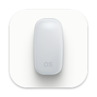
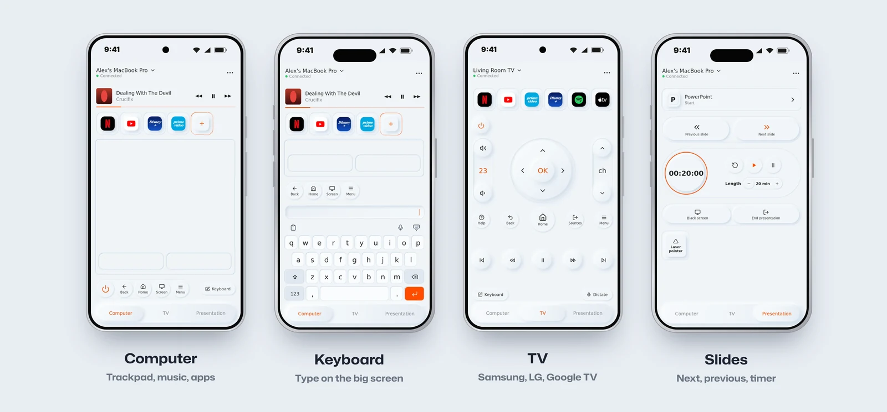

<p align="center">
  
</p>

<h1 align="center">MouseOS</h1>

<p align="center">
  <b>Your phone is your computer's mouse.</b><br>
  Trackpad, keyboard and remote for your Mac, PC, Linux computer and your TV.
</p>

<p align="center">
  <a href="https://github.com/MathisZerbib/mouseos/releases/latest"></a>
  <a href="https://github.com/MathisZerbib/mouseos/releases/latest"></a>
  <a href="https://github.com/MathisZerbib/mouseos/releases/latest"></a>
  <a href="https://mouseos.app/#beta"></a>
</p>
<p align="center">
  <a href="https://github.com/MathisZerbib/mouseos/releases/latest"></a>
  <a href="https://mouseos.app/"></a>
  
  
</p>

<p align="center"></p>

## What it does

| | |
|---|---|
| **Computer** | Trackpad, air mouse, keyboard, volume, music, your apps in one tap, see the screen on your phone. |
| **TV** | Samsung, LG and Google TV remote, keyboard included. |
| **Slides** | Next, previous, timer. |

## Get it

| Computer | Phone | TV |
|---|---|---|
| **Mac** · macOS 11+, Apple silicon · [.dmg](https://github.com/MathisZerbib/mouseos/releases/latest) | **Android** 8+ · [Google Play](https://mouseos.app/#beta) | **Samsung** |
| **Windows** · 10 & 11 · [.msi](https://github.com/MathisZerbib/mouseos/releases/latest) | **iPhone** · coming soon | **LG** |
| **Linux** · x86_64 & arm64 · [.deb / .rpm](https://github.com/MathisZerbib/mouseos/releases/latest) | | **Google TV** |

On a Mac with [Homebrew](https://brew.sh):

```sh
brew tap mathiszerbib/mouseos https://github.com/MathisZerbib/mouseos
brew install --cask mouseos
```

## Three steps

1. **Install MouseOS on your computer** and open it.
2. **Open MouseOS on your phone**, on the same Wi‑Fi, and sign in.
3. **Click ALLOW on the computer.** Your phone is the mouse.

## Private

Phone and computer talk directly over your Wi‑Fi. No tracking. Every new phone needs one ALLOW click on the computer. [Privacy policy](https://mouseos.app/privacy-policy.html) · [Terms](https://mouseos.app/terms.html)

## Stuck?

- **Mac won't open it** → System Settings → Privacy & Security → **Open Anyway**.
- **Windows protected your PC** → **More info → Run anyway**.
- **Phone doesn't find the computer** → same Wi‑Fi, VPN off, or turn on your phone's hotspot.
- **Anything else** → [support@mouseos.app](mailto:support@mouseos.app) · [FAQ](https://mouseos.app/#faq)

---

<sub>This repository hosts the MouseOS website (<a href="https://mouseos.app/">mouseos.app</a>), the Mac, Windows and Linux releases, and the Homebrew tap.</sub>
